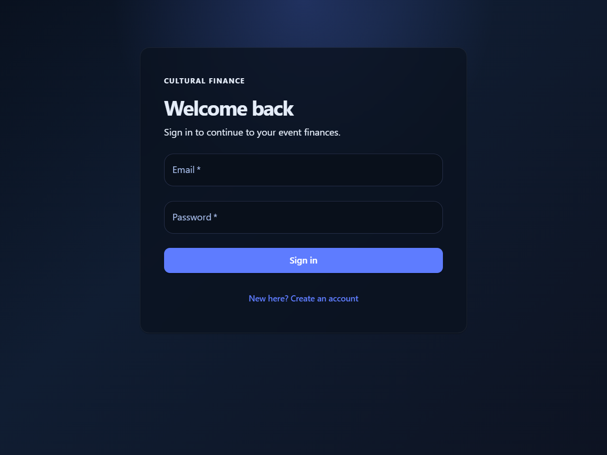
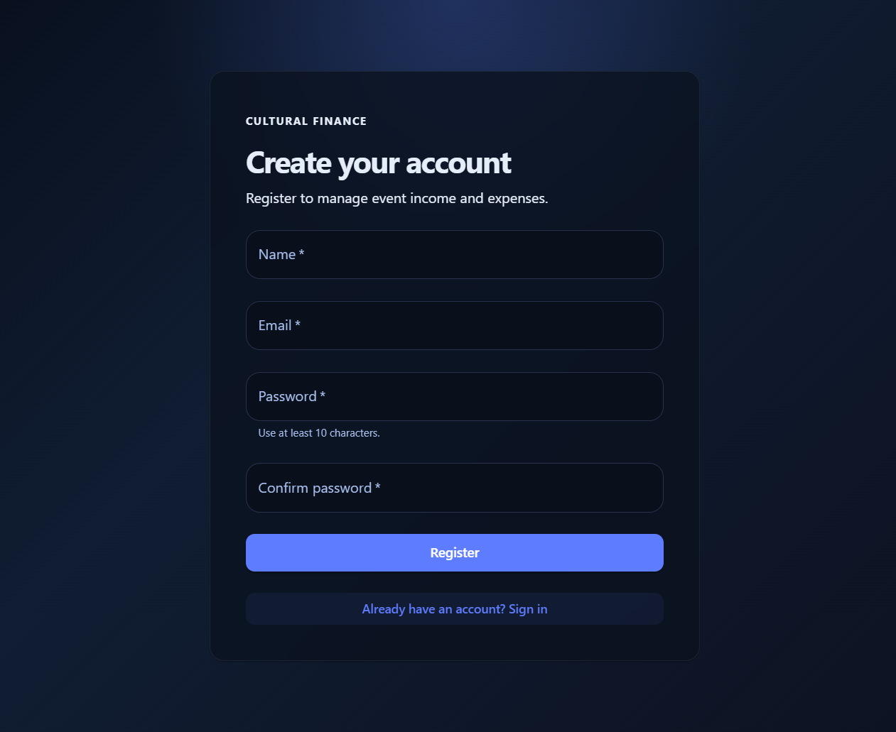

# Cultural Expense App

A web application for tracking cultural-event finances and coordinating festival
meal orders. It includes event and financial-year management, income and expense
records, event reports, and a resident meal-ordering workflow.

## Screenshots

These screenshots show the sign-in and account-registration screens. They
contain no live account or financial data.

| Sign in | Create account |
| --- | --- |
|  |  |

## Features

- **Accounts:** Register with a name, email, and password, then sign in and out.
  Passwords are stored as scrypt hashes. Sessions expire after seven days and
  are kept in the current browser session. All users currently share the same
  permissions; role-based access is not configured.
- **Financial years and events:** Create and edit financial years and events.
  Events have a date, budget, status, and description.
- **Expenses:** Add, edit, view, and delete event expenses. Expense entries
  support a category, vendor/payee, date, amount, payment details, notes, and an
  optional bill image.
- **Income:** Add, edit, view, and delete income for an event. Sources include
  Puja Donation, Sponsorship, and Subscription. Puja Donation requires a Paid
  or Pending status. Sponsorship and Subscription income is automatically
  saved with a Paid status.
- **Event reporting:** Review income and expenses for an event, including
  category/source breakdowns, and export the report to Excel or PDF.
- **Bulk income import:** Import a CSV for one event at a time. The importer
  validates all rows before inserting any of them; uploads support up to 1,000
  records and 4 MB.
- **Meal ordering:** Place and edit festival meal orders for a configured block
  and flat. Multiple menu options may be selected for the same meal, each with
  its own head count. The server calculates prices and order totals. A printed
  receipt is formatted for an 80 mm thermal printer and prints one separate
  line item for every person in each selected meal option.
- **Meal reporting:** View head counts by festival day, meal, food type, and
  menu option. A separate **Unpaid subscriptions** page lists active flats
  across all blocks that do not have a Paid Subscription for the configured
  event, includes each flat's owner name, and exports the report as CSV.

Navigation is grouped under **Expense**, **Income**, **Meal**,
**Subscriptions**, and **Event**. Hover over or select a group to open its
submenu when it contains multiple pages. **Subscriptions** opens directly to
its unpaid subscriptions page without a redundant submenu.
Expense includes **Overview** and **Add expense**; Income includes **Finances**,
**Add income**, and **Bulk income**; Meal includes **Meal ordering**, **Meal
orders**, and **Headcount summary**; Subscriptions includes **Unpaid
subscriptions**; and Event includes **Add event** and **Edit event**. The
Unpaid subscriptions page shows active flats with their owner names and
payment status, highlights those without a paid Subscription, and provides an
**Export CSV** button for the displayed report.

## Technology

- Frontend: React, TypeScript, Vite, and Material UI
- Backend: Node.js, Express, TypeScript, and PostgreSQL
- Database container for local development: PostgreSQL 16

## Requirements

- Node.js and npm
- PostgreSQL 16 (or a compatible PostgreSQL server)
- Docker Compose is optional and can be used to run the local PostgreSQL
  container

## Local setup

### 1. Start PostgreSQL

To use the included development database container, from the repository root
run:

```powershell
docker compose -f docker/docker-compose.yml up -d postgres
```

The compose file creates a local development database named
`cultural_expense_db` on port `5432`. Its checked-in credentials are for local
development only (`admin` / `admin123`); do not reuse them for a public or
production database.

Alternatively, use an existing PostgreSQL server and create an empty database
for the app.

### 2. Configure the backend

Create `backend/.env` (do not commit this file) and set the database connection:

```dotenv
PORT=3000
DB_HOST=127.0.0.1
DB_PORT=5432
DB_NAME=cultural_expense_db
DB_USER=admin
DB_PASSWORD=admin123
```

The values above match the included local development container. Change them
to match your PostgreSQL setup. `PORT` is optional; the backend uses `3000` when
it is not set. The frontend currently connects to the backend at
`http://localhost:3000`.

The frontend API URL and backend CORS allowlist are configured for local
development. Update both before deploying the app to a different host.

### 3. Initialize the database

The SQL files in `backend/migrations` are incremental migrations and assume
that the app's core tables already exist. They do not create the initial
financial-year, event, income, and expense tables. For a new empty database,
create the `cultural` schema and these core tables before applying migrations.
For an existing database, preserve its schema and data and apply the migrations
below instead.

The following is a baseline schema for a new installation:

```sql
CREATE SCHEMA IF NOT EXISTS cultural;

CREATE TABLE cultural.financial_year (
    id SERIAL PRIMARY KEY,
    name VARCHAR(50) NOT NULL,
    start_date DATE NOT NULL,
    end_date DATE NOT NULL
);

CREATE TABLE cultural.events (
    id SERIAL PRIMARY KEY,
    financial_year_id INT REFERENCES cultural.financial_year(id),
    name VARCHAR(100) NOT NULL,
    description TEXT,
    event_date DATE NOT NULL,
    budget NUMERIC(12,2),
    status VARCHAR(30) NOT NULL DEFAULT 'PLANNED'
);

CREATE TABLE cultural.income (
    id SERIAL PRIMARY KEY,
    event_id INT REFERENCES cultural.events(id),
    source VARCHAR(100) NOT NULL,
    amount NUMERIC(12,2) NOT NULL,
    income_date DATE NOT NULL,
    received_from VARCHAR(100),
    payment_mode VARCHAR(50),
    notes TEXT
);

CREATE TABLE cultural.expenses (
    id SERIAL PRIMARY KEY,
    event_id INT REFERENCES cultural.events(id),
    category VARCHAR(100) NOT NULL,
    vendor VARCHAR(100),
    amount NUMERIC(12,2) NOT NULL,
    expense_date DATE NOT NULL,
    paid_by VARCHAR(100),
    payment_mode VARCHAR(50),
    notes TEXT,
    bill_image_path TEXT,
    is_deleted BOOLEAN NOT NULL DEFAULT FALSE
);
```

Run each migration in `backend/migrations` in filename order. Use `psql`, a
database client such as pgAdmin, or another tool connected to the target
database:

1. `20261003_add_income_soft_delete.sql` — adds the income soft-delete flag.
2. `20261003_update_income_details.sql` — preserves recipient names while
   renaming `received_by` to `received_from`, and adds block and flat fields.
3. `20261004_add_authentication.sql` — creates user and session tables.
4. `20261004_add_income_payment_status.sql` — adds and constrains income
   payment status.
5. `20261007_add_meal_orders.sql` — creates meal menu/order tables and seeds
   the Durgotsav 2026 menu for October 17–21.
6. `20261008_add_meal_order_head_count.sql` — adds per-option head counts.
7. `20261009_allow_multiple_meal_options.sql` — allows multiple options for a
   meal in one order.
8. `20261010_ensure_meal_order_head_count.sql` — ensures the head-count column
   exists on installations that need the compatibility migration.
9. `20261011_add_meal_resident_directory.sql` — creates block, flat, and meal
   settings tables.
10. `20261012_add_meal_flat_owner_name.sql` — adds the optional owner name to
    each flat directory entry.

The migration scripts use idempotent operations where possible. Back up an
existing database before applying schema changes.

### 4. Install dependencies

In two terminals, install the backend and frontend dependencies:

```powershell
cd backend
npm ci
```

```powershell
cd frontend
npm ci
```

### 5. Run the app

Start the backend from `backend`:

```powershell
npm run dev
```

Start the frontend from `frontend` in a second terminal:

```powershell
npm run dev
```

Open [http://localhost:5173](http://localhost:5173). The backend listens on
port `3000` by default.

## First-time configuration

1. Open the app and create an account from the sign-in screen. Passwords must
   contain 10–128 characters.
2. Create one or more financial years.
3. Create events and then add income and expense records under the appropriate
   event.
4. For meal ordering and subscription reporting, populate
   `cultural.meal_order_blocks` and `cultural.meal_order_flats` with block
   names, flat numbers, and owner names.
5. Set `cultural.meal_order_settings.subscription_event_id` to the event ID
   used for the festival Subscription income.

The complimentary Astami lunch option is available only to a flat with a
non-deleted Subscription income record for the configured event. The
Subscription record must have matching block and flat values. If the
subscription event setting is not configured, the server rejects orders that
include the complimentary option.

## API overview

The Express API runs on port `3000` by default. Account registration and sign-in
are provided by `/auth`; the financial-year, event, income, expense, and
meal-order route groups are `/financial-years`, `/events`, `/income`,
`/expenses`, and `/meal-orders`. All routes other than account registration
and sign-in require an authenticated session. Expense bill images are served
from `/uploads`.

## Bulk income CSV

Use the **Bulk income** tab and the provided
[`income-upload-sample.csv`](frontend/public/income-upload-sample.csv). Upload
one event per CSV file. The file must be no larger than 4 MB and contain no more
than 1,000 data rows.

| Column | Required | Details |
| --- | --- | --- |
| `source` | Yes | `Puja Donation`, `Sponsorship`, or `Subscription` |
| `received_from` | Yes | Recipient/payer name, at most 100 characters |
| `amount` | Yes | Positive amount, up to two decimal places |
| `income_date` | Yes | Valid date in `YYYY-MM-DD` format |
| `block` | No | At most 100 characters |
| `flat_no` | No | At most 100 characters |
| `payment_mode` | No | At most 50 characters |
| `payment_status` | No | Required for Puja Donation (`Paid` or `Pending`); leave blank for Sponsorship and Subscription |
| `notes` | No | Free-form description |

Sponsorship and Subscription rows are stored with `Paid` status automatically.
The import validates every row first and inserts all records together. If any
row is invalid, none of the rows are imported.

## Windows launcher

The repository includes `CulturalExpenseApp.exe` and
`StopCulturalExpenseApp.cmd` for launching the app on Windows. Before using the
launcher:

- Install Node.js and make sure it is available on `PATH`.
- Run `npm ci` in both `backend` and `frontend`.
- Configure `backend/.env`.
- Start PostgreSQL (for the included container, use the compose command above).

Double-click `CulturalExpenseApp.exe`. It starts the backend and frontend,
waits for them to respond, and opens `http://127.0.0.1:5173`. The console can
be closed without stopping the services. To stop them, enter `S` and press
Enter in the launcher console, or run `StopCulturalExpenseApp.cmd`. Service
output is written to `logs/`. To rebuild the launcher after changing its
source, run `launcher\build.ps1` in Windows PowerShell.

## Troubleshooting

- **The app cannot connect to PostgreSQL:** Check that PostgreSQL is running,
  verify the `DB_*` values in `backend/.env`, and confirm the selected port is
  available.
- **The frontend loads but API requests fail:** Confirm the backend is running
  on port `3000` and that database migrations have completed.
- **Authentication tables are missing:** Apply
  `backend/migrations/20261004_add_authentication.sql` and restart the backend.
- **Meal head-count setup is reported missing:** Apply
  `backend/migrations/20261010_ensure_meal_order_head_count.sql` and restart
  the backend.
- **Meal residents are unavailable:** Apply
  `backend/migrations/20261011_add_meal_resident_directory.sql` and populate
  the block/flat directory tables.
- **Owner names are missing from the subscription report:** Apply
  `backend/migrations/20261012_add_meal_flat_owner_name.sql` and populate
  `owner_name` in `cultural.meal_order_flats`.
- **Complimentary lunch is unavailable:** Verify that the meal settings row
  references the correct event and that the selected flat has a Subscription
  income record for that event.

## Project layout

```text
backend/
  migrations/       PostgreSQL schema upgrades
  src/routes/       Express API routes
  uploads/bills/    Uploaded expense bill images
frontend/
  public/            Static assets and sample CSV
  src/pages/         Application screens
  src/components/    Shared UI components
docker/
  docker-compose.yml Local PostgreSQL service
launcher/            Windows launcher source
docs/screenshots/     README UI screenshots
```

## Development scripts

Run scripts from the relevant package directory:

| Directory | Command | Description |
| --- | --- | --- |
| `backend` | `npm run dev` | Start the Express API with `ts-node-dev` |
| `frontend` | `npm run dev` | Start the Vite development server |
| `frontend` | `npm run build` | Type-check and build the production frontend |
| `frontend` | `npm run lint` | Run ESLint |

The backend package does not currently define a test suite.
